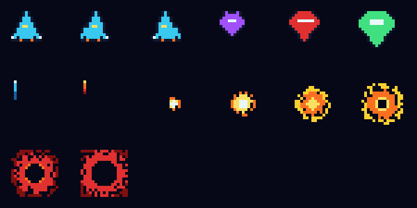

# STM32 彩屏多页小游戏机

基于 **STM32F103C8T6** + **标准外设库（SPL）** + **1.8 寸 ST7735S 彩屏** 的多页小游戏机
（Keil MDK5 工程）。用两个翻页键在 4 个页面之间切换，其中两页是可以玩的小游戏。

```
第 1 页  照片          竖屏 128x160   一张照片，256 色调色板存内部 Flash
第 2 页  重力颗粒      竖屏 128x160   MPU6050 倾斜控制，72 颗小球滚动、互撞
第 3 页  小恐龙跑酷    横屏 160x128   滚动 + 跳跃 + 碰撞，类似 Chrome 断网小游戏
第 4 页  太空射击      竖屏 128x160   三种敌机 + 粒子爆炸 + 自动开火
```



---

## 1. 硬件清单

| 元器件 | 数量 | 说明 |
| --- | --- | --- |
| STM32F103C8T6 最小系统板（蓝板） | 1 | 主控，72MHz，64KB Flash / 20KB RAM |
| ST-Link V2 | 1 | 下载 + 调试（SWD），也可给板子供电 |
| 1.8 寸 TFT 彩屏（ST7735S，SPI） | 1 | 128×160，RGB565，丝印 `GND VCC SCL SDA RES DC CS BLK` |
| MPU6050 六轴模块 | 1 | 第 2 页的倾斜感应（只用加速度计） |
| 轻触按键 | 4 | 翻页 ×2、游戏键 ×2 |
| 面包板 + 杜邦线 | 1 套 | 搭电路 |
| W25Q64 SPI Flash 模块 | 可选 | 驱动已写好（`my_lib/w25q64.c`），本项目暂未使用 |

## 2. 接线表

蓝板丝印是简写：`PA5` 印成 **A5**、`PB0` 印成 **B0**。

### 2.1 TFT 彩屏（SPI1）

| TFT 引脚 | 接到蓝板 | 说明 |
| --- | --- | --- |
| GND | GND | 共地 |
| VCC | **3V3** | 千万不要接 5V |
| SCL / SCK | **PA5** | SPI1 时钟 |
| SDA / MOSI | **PA7** | SPI1 数据 |
| RES / RST | **PA0** | 复位 |
| DC / RS | **PA1** | 命令/数据选择 |
| CS | **PA4** | 片选 |
| BLK / BL | **3V3** | 背光常亮 |

### 2.2 MPU6050（I2C1）

| MPU6050 | 接到蓝板 |
| --- | --- |
| VCC | 3V3 |
| GND | GND |
| SCL | **PB6** |
| SDA | **PB7** |
| AD0 | GND（地址 = 0x68） |
| INT | 不接（轮询） |

### 2.3 四个按键

每个按键只用两个脚：一端接引脚，另一端接 **GND**（程序里开了内部上拉，不用外接电阻）。

| 按键 | 引脚 | 作用 |
| --- | --- | --- |
| 下一页 | **PA2** | 翻页（所有页面都有效） |
| 上一页 | **PA3** | 翻页（所有页面都有效） |
| 游戏键 A | **PB0** | 恐龙页 = 跳跃；太空射击页 = 左移 |
| 游戏键 B | **PB1** | 恐龙页 = 开始/复活；太空射击页 = 右移 |

> 太空射击页的**开始 / 复活**是「**双击** PB0 或 PB1」（只在标题界面和结束界面生效）。

### 2.4 ST-Link

| ST-Link | 蓝板 |
| --- | --- |
| SWDIO | PA13 |
| SWCLK | PA14 |
| GND | GND |
| 3.3V | 3V3 |

**三条铁律**：所有模块必须共地；除屏幕背光外供电都用 3V3；接完线按一下复位。

---

## 3. 目录结构

```
stm32模板/
├── user/                        用户代码（本项目主要改这里）
│   ├── main.c                   ★ 四个页面的调度 + 按键 + 各页入口
│   ├── game.c / game.h          ★ 第 4 页：太空射击
│   ├── sprites.c / sprites.h    ★ 太空射击的像素精灵（16 色调色板索引图）
│   ├── photo.c / photo.h        ★ 第 1 页：照片（256 色，约 20.5KB）
│   ├── stm32f10x_it.c           中断服务函数（SysTick 计时）
│   └── system_stm32f10x.c/.h    系统时钟（72MHz）
├── my_lib/                      可复用驱动
│   ├── st7735.c/.h              ★ ST7735S 彩屏：SPI+DMA、行缓冲逐行合成、
│                                  画线/画圆/填充/位图/ASCII 文字/横竖屏
│   ├── font8x8.c/.h             ★ 8x8 ASCII 字库（脚本生成）
│   ├── mpu6050.c/.h             ★ MPU6050 加速度计（I2C）
│   ├── w25q64.c/.h              ★ W25Q64 SPI Flash（备用）
│   ├── button.c/.h              按键驱动（上拉 + 消抖 + 回调）
│   ├── delay.c/.h               SysTick 延时 / 计时
│   ├── i2c.c/.h, usart.c/.h, spi.c/.h, si2c.c/.h, oled.c/.h
├── std_periph_driver/           ST 官方标准外设库 V3.6.0
├── startup/                     启动文件（本工程用 startup_stm32f10x_md.s）
└── my_app/                      资料与工具脚本
    ├── gen_photo.py             ★ 图片 -> user/photo.c（256 色调色板）
    ├── gen_sprites.py           ★ 程序化画像素精灵 -> user/sprites.c
    ├── gen_font8x8.py           ★ 生成 8x8 ASCII 字库
    ├── png2rgb565.py            把任意 PNG 转成 RGB565 C 数组
    ├── sprites_preview.png      精灵预览图
    └── main_backup_*.c          以前几版 main.c 的备份
```

## 4. 编译与烧录

1. Keil µVision 5（MDK5，ARMCC V5）打开 `stm32模板.uvprojx`；
2. `F7` 编译（当前 **0 Error 0 Warning**）；
3. 接好 ST-Link，`F8` 下载；也可以用别的工具烧 `Objects/template.hex`。

> Keil 里若看到中文注释乱码：`Edit → Configuration → Encoding` 选 **UTF-8**，不影响编译。
> 屏幕花屏就把 `my_lib/st7735.h` 里的 `ST7735_SPI_PRESCALER` 从 `_4` 改成 `_8`（降速）。

## 5. 各页实现要点

### 5.1 照片页

直接存 RGB565 要 `128×160×2 = 40KB`，而内部 Flash 一共才 64KB，所以转成
**256 色调色板 + 每像素 1 字节下标**（`256×2 + 128×160 = 20992` 字节 ≈ 20.5KB），
在 1.8 寸屏上几乎看不出区别。显示时逐行把下标翻成 RGB565 再推给屏幕。

换照片：

```bash
python my_app/gen_photo.py <你的图片>     # 重新生成 user/photo.c，然后重新编译
```

### 5.2 重力颗粒页

MPU6050 静止时测到的是「支持力」，所以直接把 ax/ay 当作**屏幕平面内的重力**：
屏幕朝上平放时平面内没有重力，珠子会失重漂浮；竖着拿起来珠子才会往下掉——这
是物理上正确的做法，比「归一化 + 阈值」更真实。珠子间用等质量弹性碰撞 + 位置
修正，撞墙放在最后一步做，保证珠子一定被关在屏幕里。

> 这块 MPU6050 相对屏幕转了 90°，所以两个轴在代码里是对调的
> （`Gravity_Update()`）；方向不对只改 `GRAV_SIGN_X` / `GRAV_SIGN_Y` 的符号即可。

### 5.3 小恐龙跑酷页

经典跑酷三件套：障碍物从右往左匀速滚动、跳跃是抛物线、碰撞用 AABB。恐龙由几个
方块拼成，跑动时两条腿一长一短做出跑步动画；撞死后用一个闪烁的红框当"按开始键
复活"的提示（这一页没有用字库，不想在游戏画面上加字）。

这一页是**横屏**，切页时用 `ST7735_SetRotation()` 换方向，屏幕宽高自动对调。

### 5.4 太空射击页

**这是整个项目里最花心思的一页。**

F103C8T6 只有 20KB RAM，**放不下整屏显存**，所以既没有双缓冲也不能整屏重绘。
这里用的是嵌入式小游戏常用的 **脏矩形 + 逐行合成**：

1. 每帧先算出"哪些小矩形变了"（移动物体的旧位置 + 新位置）；
2. 只重画这些矩形：每一行先在 320 字节的行缓冲里铺背景（星空），再依次叠上
   粒子、爆炸、敌机、子弹、飞船，最后**用 DMA 把这一行推给屏幕**；
3. 星空滚动每 200ms 才跳 1 像素，跳的那一帧把整个游戏区标成脏矩形重画一次。

于是 25 帧/秒里有 24 帧只刷几个小方块，只有 5 帧/秒整块重画背景。

其他细节：

- 速度/位置用 **8.8 定点**，全程不用浮点（Cortex-M3 没有 FPU）；
- 对象全部是**固定数组对象池**（子弹10 / 敌机6 / 敌弹6 / 粒子36 / 爆炸4 / 星星42），
  **不使用 malloc**；
- 三种敌机：侦察机（快、1 血）、战斗机（中、2 血）、精英机（慢、3 血），被打中会闪白；
- 爆炸是 **6 帧程序化生成的精灵 + 粒子系统**（粒子有生命期、速度、颜色衰减）；
- 还有屏幕震动、受击闪白、引擎尾焰、子弹拖尾等细节。

## 6. Flash / RAM 占用

```
Code 14428 + RO-data 24644 + RW-data 132 = 39204 字节 ≈ 38.3 KB / 64 KB
ZI-data 7196 + RW-data 132               ≈  7.3 KB / 20 KB
```

其中照片占 20.5KB、精灵约 2.6KB、8x8 字库 0.75KB。
`my_lib/oled.c` 是套件自带但本项目未使用的驱动，链接器会自动丢掉它的代码段。

## 7. 说明与致谢

- `my_lib/` 里的基础驱动（按键、延时、软件 I2C 等）来自 B 站 **铁头山羊** 的
  《STM32 入门教程（第 4 版）基础套件》，本项目仅作个人学习使用；
  `st7735.c/h`、`font8x8.c/h`、`mpu6050.c/h`、`w25q64.c/h` 和四个页面是本项目新写的。
- `std_periph_driver/` 为 ST 官方标准外设库 V3.6.0。
- 照片页那张图仅作演示。
